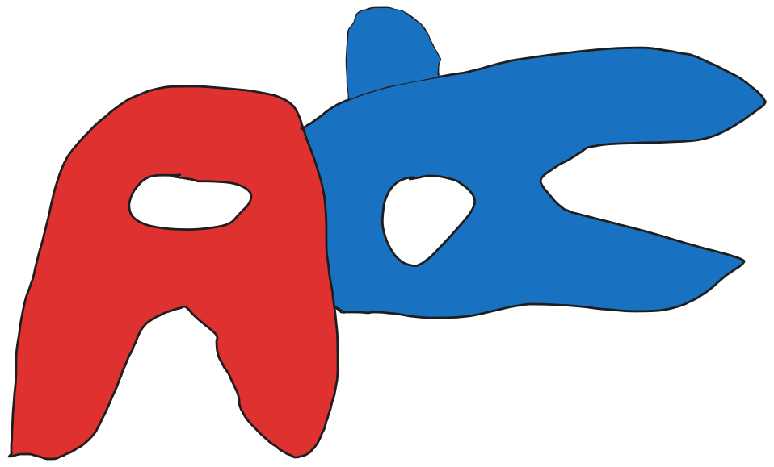

<!--
SPDX-FileCopyrightText: 2026 Jason Scheffel <contact@jasonscheffel.com>
SPDX-License-Identifier: CC-BY-SA-4.0
-->

# eigenvibes

[](https://github.com/jason-scheffel/eigenvibes/actions/workflows/ci.yml)
[](LICENSE)
[](pyproject.toml)
[](https://github.com/astral-sh/uv)
[](https://github.com/astral-sh/ruff)
[](https://mypy-lang.org/)
[](https://api.reuse.software/info/github.com/jason-scheffel/eigenvibes)

<p align="center"></p>

> Course project for CSI 436/536 (Fall 2026, University at Albany).
>
> This project checks whether explanations of neural networks give the right answer. To know the right answer, it uses synthetic data.
>
> The data describe fictional Among Us players. Each player has 12 behavior numbers, such as time spent near vents or time spent alone, and a formula we chose turns them into a **sus score**: how suspicious the player looks. Neural networks learn to predict sus from the 12 numbers. Then we follow a group of players for four rounds. Impostors' sus rises every round, and crewmates' sus stays flat.
>
> We ask each trained network *why* impostors' sus rises, and compare its answer with the truth. The answer is one amount per behavior, and the amounts add up to the rise: for example, 1.0 of the rise came from `task_inactivity`, 0.125 from `task_abandonment`, and so on. It is computed in two steps:
>
> 1. Integrated Gradients [1] explains each single prediction: it splits the predicted sus into how much each behavior contributed.
> 2. A mixed model (a regression for repeated measurements of the same players) combines those per-prediction amounts into amounts for the difference between the impostors' rise and the crewmates' rise.
>
> In [2], this method explained a VNN's brain-age predictions for two groups of patients. On real data, however, nobody knows the true amounts, so there is no way to check whether they are right. Here we wrote the formula, so we know the true amounts exactly.
>
> We compare:
>
> - **Models.** A VNN (coVariance Neural Network [3]) uses the covariance matrix of the 12 behaviors, estimated from its training data, as a graph that links behaviors that vary together, and each layer mixes every behavior with the behaviors it is linked to. An MLP, a standard fully connected network, has no such built-in structure. Ridge regression, a linear model, is the simple baseline.
> - **Two formulas for sus.** One adds up its parts; the other also multiplies two of them.
> - **A decoy.** One behavior rises for impostors but has no effect on sus, so a correct explanation gives it no credit.
>
> [Datasets](#datasets) describes the data in detail.

## Contents

- [Requirements](#requirements)
- [Installation](#installation)
- [Datasets](#datasets)
- [GPU benchmark](#gpu-benchmark)
- [Tuning](#tuning)
- [Final training](#final-training)
- [Evaluation](#evaluation)
- [Results](#results)
- [Contributors](#contributors)
- [Use of generative AI](#use-of-generative-ai)
- [License](#license)
- [References](#references)

## Requirements

Python 3.14 and [uv](https://docs.astral.sh/uv/). uv installs Python 3.14 itself if it is missing. Intel Macs are not supported because PyTorch no longer publishes builds for them.

## Installation

Clone the repository, then run one of these commands from its root, depending on your hardware. Each installs the project, its dependencies, and the matching PyTorch build.

```
uv sync --extra cu130   # NVIDIA GPU on Linux or Windows (driver 580 or newer)
uv sync --extra cu126   # NVIDIA GPU with driver 525.60.13 or newer (Windows: 528.33) but older than 580; no RTX 50-series
uv sync --extra rocm    # AMD GPU on Linux
uv sync --extra cpu     # no GPU, macOS, or an AMD GPU on Windows
```

Plain `uv sync` and `uv remove` uninstall PyTorch. Run your command again after either one.

Run scripts with `uv run python <script>`.

## Datasets

`uv run python scripts/make_datasets.py download` downloads every dataset into `data/` (gitignored) from the [Hugging Face dataset](https://huggingface.co/datasets/jason-scheffel/eigenvibes), at the upload our results use. It also downloads our tuning studies and trained models into `results/tuning/` and `results/final/` (gitignored), so the [results](#results) can be reproduced without retraining. `uv run python scripts/make_datasets.py generate` instead writes them from their seeds in a few seconds. Another CPU may round the last digit of some numbers differently, which does not change any result.

### Files

```
data/
  README.md        the Hugging Face dataset card (in git)
  covariance.csv   how the 12 behaviors vary together
  design.json      the formulas, the cohort settings and the true answers
  linear/          sus from the linear formula
    evaluation_00/ ... evaluation_29/
      train.csv  validation.csv  test.csv  cohort.csv
    tuning_30/ ... tuning_39/
      train.csv  validation.csv
  interaction/     sus from the interaction formula; same layout
```

The number in a folder name is the seed that made the dataset. Tuning datasets are only for choosing hyperparameters, and evaluation datasets are only for final results. Both formulas use the same players, so only the `sus` column differs between `linear/` and `interaction/`.

| File | Rows | Columns |
|---|---:|---|
| `train.csv` | 2,000 | 12 behaviors, `sus` |
| `validation.csv` | 500 | same |
| `test.csv` | 2,000 | same |
| `cohort.csv` | 800 | `player`, `round`, `impostor`, 12 behaviors, `sus` |

Read the files with `pandas.read_csv(..., float_precision="round_trip")` to get every value back exactly.

### Behaviors

Each row is a made-up player with 12 behavior scores. A score of 0 is a typical player, and every behavior has a standard deviation of 1. The behaviors are correlated because they come from three hidden play styles: slacking, sneaking and moving. `covariance.csv` holds the exact correlations.

| # | Behavior | Play style |
|---|---|---|
| 1 | `task_inactivity` | slacking |
| 2 | `vent_lingering` | sneaking |
| 3 | `time_alone` | sneaking, some slacking |
| 4 | `quiet_room_preference` | sneaking |
| 5 | `task_abandonment` | slacking |
| 6 | `following_players` | sneaking, some moving |
| 7 | `distance_walked` | moving |
| 8 | `room_changes` | moving |
| 9 | `walking_speed` | moving |
| 10 | `hallway_time` | moving, some sneaking |
| 11 | `route_variability` | slacking, some moving |
| 12 | `task_station_proximity` | less slacking |

### Sus

- **linear:** sus = 2 `task_inactivity` + `vent_lingering` + 0.5 `task_abandonment`
- **interaction:** the linear formula + `task_inactivity` × `vent_lingering`

The other 9 behaviors do not affect sus. In `train.csv` and `validation.csv`, sus also has noise with a standard deviation of 10% of sus's; in `test.csv` and `cohort.csv`, sus is exact.

### Cohort

The cohort follows 200 players for 4 rounds (0 to 3), and odd-numbered players are impostors. Part of each player's behavior stays the same every round (60% of the variance), and the rest changes from round to round. The cohort's players linger near vents more than the training players: their `vent_lingering` averages 1 instead of 0.

Every round, impostors' `task_inactivity` rises by 0.5, their `task_abandonment` by 0.25 and their `route_variability` by 0.35. `route_variability` is a decoy, because it rises but does not affect sus.

### True answers

Impostors' sus rises faster than crewmates' every round. Integrated Gradients splits each sus score among the behaviors, and the true answer is each behavior's share of that faster rise:

| Behavior | linear | interaction |
|---|---:|---:|
| `task_inactivity` | 1.000 | 1.250 |
| `vent_lingering` | 0 | 0.250 |
| `task_abandonment` | 0.125 | 0.125 |
| `route_variability` (decoy) | 0 | 0 |
| the other 8 | 0 | 0 |
| **total** | **1.125** | **1.625** |

In the interaction formula, `vent_lingering` gets credit even though it does not change. The product term rises because `task_inactivity` rises while `vent_lingering` is high, and Integrated Gradients splits that rise evenly between the two behaviors.

## GPU benchmark

`scripts/benchmark.py` measures how fast VNNs train on a GPU and whether training several at the same time on one GPU gets more done than training them one after another. It only prints its results. On the DGX, run it with `sbatch scripts/benchmark.sbatch`.

Results on one NVIDIA A100-SXM4-80GB (October 2026, torch 2.14.1+cu126), training copies of a 3-layer VNN with 128 channels and 8 filter taps per layer on 2,000 rows. Each value is the total epochs per second of all models together, relative to one model alone:

| Models at once | Batch 2 | Batch 8 | Batch 32 |
|---:|---:|---:|---:|
| 1 | 1.00x | 1.00x | 1.00x |
| 2 | 2.04x | 2.12x | 1.98x |
| 4 | 3.84x | 3.77x | 3.75x |
| 8 | 4.03x | 4.08x | 3.89x |
| 16 | 4.04x | 4.10x | 3.89x |

Our training scripts therefore run 4 models at once on each GPU. Four gets nearly all of the gain. Eight adds at most 8% more throughput but doubles the time each model takes, so each result arrives later; Optuna picks each new trial from the finished ones, so earlier results matter more than a few percent of throughput.

A training step also takes about as long at batch size 2 as at 32 (about 3.3 ms for this model), so an epoch at batch size 2 takes about 16 times longer.

## Tuning

`scripts/tune.py` tunes each model's hyperparameters with [Optuna](https://optuna.org/), separately for each formula, which makes four studies: `mlp_linear`, `mlp_interaction`, `vnn_linear` and `vnn_interaction`. A trial trains one set of hyperparameters on each of the 10 tuning datasets, and its score is the mean validation MSE. Training uses Adam on MSE, stops after 25 epochs without a lower validation loss (or at 1,500 epochs), and keeps the weights of the best epoch. A VNN uses the covariance estimated from the dataset's training split. Each study runs 100 trials and starts from known good settings: the two best VNNs of an earlier tuning run, and an MLP with two layers of 128.

| Hyperparameter | Range |
|---|---|
| Learning rate | 1e-4 to 1e-2, log scale |
| Batch size | 16, 32, 64 or 128 |
| Layers | 1 to 4 |
| Width per layer | 1 to 256 |
| VNN filter taps per layer | 1 to 12 |

On the DGX, download the data with a small CPU job (the login node does not give uv enough memory), then submit the tuning job from the clone:

```
srun --cpus-per-task=4 --mem=16G --time=00:30:00 uvx --from huggingface-hub hf download jason-scheffel/eigenvibes --repo-type dataset --revision dbdc1ef9d1e1fe45294538756ec17e0e7ede074d --local-dir data
sbatch scripts/tune.sbatch
```

It starts 8 copies of the script, one A100 each: copies 0–3 tune `vnn_interaction`, 4–5 `vnn_linear`, 6 `mlp_linear` and 7 `mlp_interaction`. Each copy trains 4 models at a time (see [GPU benchmark](#gpu-benchmark)). To resume a stopped run, submit the job again. To run one copy on another machine, use `uv run python scripts/tune.py <copy>`.

It writes to `results/tuning/` (gitignored): each study as an Optuna journal file `<study>.log`, each copy's run time in `nodes/`, and `summary.json` with the best trial of each study.

## Final training

After tuning, `sbatch scripts/train_final.sbatch` trains the final models: for each formula, model and evaluation dataset, one model with seed 42 and the best hyperparameters of its study, 120 models in all. It refuses to start until every study has 100 finished trials. A model stops early on its validation split and is scored on `test.csv`, whose sus has no noise, by RMSE and R². Integrated Gradients then explains its prediction for every row of the dataset's `cohort.csv`, from the all-zero player, with 512 steps.

It writes to `results/final/<formula>/<model>/` (gitignored), per dataset:

- `<dataset>.pt`: the weights, the hyperparameters and the scores, plus the covariance for a VNN.
- `<dataset>_ig.csv`: per cohort row, its `player`, `round`, `impostor`, the model's `prediction`, and one attribution per behavior.
- `<dataset>.json`: the scores, the epochs, the training time, and the completeness gap: the largest difference between a row's attributions added up and its prediction minus the prediction for the all-zero player.

## Evaluation

`uv run python scripts/evaluate.py` makes every table and figure from `data/` and `results/final/`, on the CPU in a few seconds. `results/final/` comes from final training or from `make_datasets.py download`. It also fits ridge regression on each evaluation dataset, with its penalty chosen on the validation split; its attributions are its coefficients times the behaviors.

For each model and dataset, it splits the impostors' extra rise in sus into one amount per behavior: the impostor-by-round coefficient of a least squares fit to each behavior's attributions over the cohort. Every player is in every round, so this equals the fixed effect of a mixed model with a random intercept and slope per player. It compares the amounts with those of the true formula on the same cohort, so the error comes from the model alone.

It writes to `results/`:

- `evaluation/summary.csv` and `summary.tex`: per formula and model, the mean test R², the mean absolute error of the 12 amounts, the decoy's amount, the error of their total, and the attributions' RMSE per cohort row, with standard errors over the 30 datasets.
- `evaluation/contributions.csv`: every amount, for every formula, model and dataset.
- `figures/contributions.{pdf,png}`: each model's mean amounts next to the true formula's.
- `figures/trajectories.{pdf,png}`: mean sus by round for impostors and crewmates, with each model's mean prediction.

## Results

`uv run python scripts/make_datasets.py download` followed by `uv run python scripts/evaluate.py` reproduces these numbers. Each is a mean over the 30 evaluation datasets. The errors compare each model's amounts with those of the true formula on the same cohort, where the impostors' extra sus per round adds up to about 1.1 (linear) and 1.6 (interaction).

| Formula | Model | Test R² | Mean error per behavior | Error of the total | Decoy's amount |
|---|---|---:|---:|---:|---:|
| linear | ridge | 0.9999 | 0.0007 | −0.003 | 0.000 |
| linear | MLP | 0.9999 | 0.0008 | −0.005 | −0.002 |
| linear | VNN | 0.996 | 0.005 | −0.022 | −0.001 |
| interaction | ridge | 0.860 | 0.044 | −0.502 | 0.003 |
| interaction | MLP | 0.998 | 0.005 | −0.036 | 0.001 |
| interaction | VNN | 0.920 | 0.041 | −0.342 | 0.008 |

Models that fit well give the right amounts. Ridge cannot represent the product term, so it gives `vent_lingering` none of its true 0.24 and misses about 0.5 of the 1.6 extra sus per round, close to a third. The VNN fits the interaction formula less well than the MLP, and it gives `vent_lingering` only 0.09. No model gives the decoy any real credit.

## Contributors

<p align="center"><a href="https://github.com/jason-scheffel/eigenvibes/graphs/contributors"></a></p>

`uv run python scripts/contributors.py` redraws this image from the repository's contributor list on GitHub. Run it after someone's first pull request is merged, once GitHub's [contributors page](https://github.com/jason-scheffel/eigenvibes/graphs/contributors) shows them; GitHub can take a few hours to update the list.

## Use of generative AI

This project uses generative AI tools (see section 4.8 of the [course syllabus](https://chong-l.github.io/CSI436_536_26F.html)):

- Coding agents help write and edit some of the code, tests, and documentation.
- Inline code completion in our editors suggests code as we type, though not all suggestions are accepted.
- Commit messages and pull request descriptions are sometimes written with AI help.
- GPT-6 Astra, run locally, is the first reviewer: we run it on changes before pushing them.
- CodeRabbit then reviews pull requests.

Coding agents do not act on their own. We tell them specifically what to do, and the only work they do unprompted is routine, such as exploring the codebase for context. Some of the code also follows high-level designs from earlier projects, similar to design patterns.

We read every line before it is merged and stand by all of it. We further verify the work by:

- tests, run in CI on Linux, Windows, and macOS;
- comparisons with known answers, for instance a bit-for-bit comparison of the VNN against the earlier implementation it replaces;
- identities the method must satisfy exactly, for instance the components summing to the total effect.

Some findings and bugs were found by AI tools rather than by us. We checked each one before relying on it:

| Finding | Found by |
| --- | --- |
| On ROCm, GPU matrix products with more than 524,288 rows return wrong values without an error. | Claude Opus 5.5 |
| A covariance matrix that carries gradients leaks them back into the data it was computed from, so the VNN detaches it. | Claude Opus 5.5 |
| Averaging the VNN's last layer over channels rounds differently depending on memory layout, so matching the earlier implementation exactly needs a contiguous copy. | Claude Opus 5.5 |
| Reproducing the earlier implementation's seeded initialization requires one extra set of random draws that it made and discarded. | Claude Opus 5.5 |
| Tiny rounding differences in a model's output depend on the batch size, so batch sizes must stay fixed for results to reproduce exactly. | Claude Opus 5.5 |
| The VNN's prediction and its regional outputs round differently, so a regional residual that should be zero came out around 1e-16 and was normalized into a full-length direction instead of raising an error. | GPT-6 Astra |
| The CI workflow referred to GitHub Actions by release tags, which can be moved to point at different code, and kept the job's token in `.git/config` after checkout. | CodeRabbit |
| The covariance check accepted matrices containing NaN, because comparisons with NaN are false, so the eigendecomposition later failed with a misleading error. | CodeRabbit |
| Prediction split its input into chunks of 524,288 divided by the number of nodes, which is 0 for graphs with more nodes than that and makes the split fail. | CodeRabbit |
| If a benchmark worker failed to start, the workers already running waited forever, and Python hung on exit. | CodeRabbit |
| The cu126 build needs NVIDIA driver 525.60.13 on Linux and 528.33 on Windows, not any 525 release. | CodeRabbit |
| A test required an exact zero from values recomputed after a round trip through CSV, which can fail from last-digit rounding on another platform. | CodeRabbit |

## License

The code is licensed under the BSD 3-Clause License. See [LICENSE](LICENSE) for the full text. Documentation and other prose, including this README, is under [CC BY-SA 4.0](LICENSES/CC-BY-SA-4.0.txt). Config files and the generated data in `data/` are under [CC0 1.0](LICENSES/CC0-1.0.txt).

The crewmate drawings in `docs/crewmates.svg` and `docs/contributors.svg` are fan art and are not under any of these licenses. This project is not affiliated with Among Us or Innersloth LLC; see [the fan art notice](LICENSES/LicenseRef-Among-Us-Fan-Art.txt) for details.

## References

[1] M. Sundararajan, A. Taly, and Q. Yan, "Axiomatic Attribution for Deep Networks," in *Proc. 34th International Conference on Machine Learning (ICML)*, 2017. https://arxiv.org/abs/1703.01365

[2] J. Scheffel and S. Sihag, "Covariance Eigenspace Provides Latent Attribution of Longitudinal Effects in Brain Age Gap," arXiv:2609.40202, 2026. https://arxiv.org/abs/2609.40202

[3] S. Sihag, G. Mateos, C. McMillan, and A. Ribeiro, "coVariance Neural Networks," in *Advances in Neural Information Processing Systems (NeurIPS)*, 2022. https://arxiv.org/abs/2205.15856
