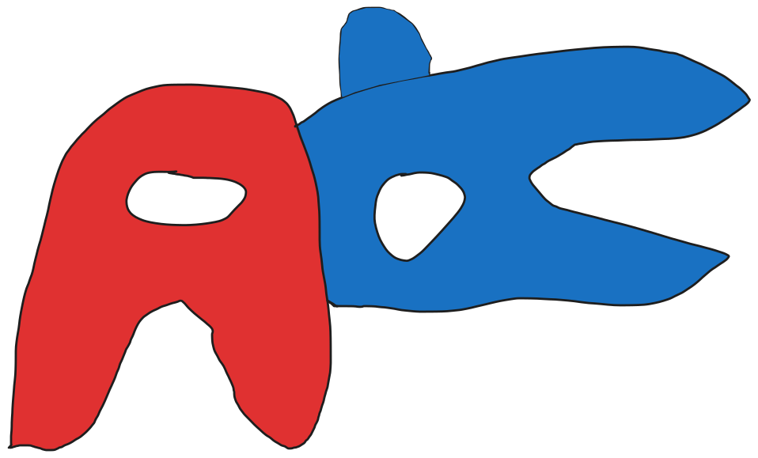

<!--
SPDX-FileCopyrightText: 2026 Jason Scheffel <contact@jasonscheffel.com>
SPDX-License-Identifier: CC-BY-SA-4.0
-->

# eigenvibes

[](https://github.com/jason-scheffel/eigenvibes/actions/workflows/ci.yml)
[](LICENSE)
[](pyproject.toml)
[](https://github.com/astral-sh/uv)
[](https://github.com/astral-sh/ruff)
[](https://mypy-lang.org/)
[](https://api.reuse.software/info/github.com/jason-scheffel/eigenvibes)

<p align="center"></p>

Course project for CSI 436/536 (Fall 2026, University at Albany).

This project checks whether explanations of neural networks give the right answer. To know the right answer, it uses synthetic data.

The data describe fictional Among Us players. Each player has 12 behavior numbers, such as time spent near vents or time spent alone, and a formula we chose turns them into a **sus score**: how suspicious the player looks. Neural networks learn to predict sus from the 12 numbers. Then we follow a group of players for four rounds. Impostors' sus rises every round, and crewmates' sus stays flat.

We ask each trained network *why* impostors' sus rises, and compare its answer with the truth. The answer is one amount per behavior, and the amounts add up to the rise: for example, 0.3 of the rise came from `vent_lingering`, 0.2 from `time_alone`, and so on. It is computed in two steps:

1. Integrated Gradients [1] explains each single prediction: it splits the predicted sus into how much each behavior contributed.
2. A mixed model (a regression for repeated measurements of the same players) combines those per-prediction amounts into amounts for the difference between the impostors' rise and the crewmates' rise.

In [2], this method explained a VNN's brain-age predictions for two groups of patients. On real data, however, nobody knows the true amounts, so there is no way to check whether they are right. Here we wrote the formula, so we know the true amounts exactly.

We compare:

- **Networks.** A VNN (coVariance Neural Network [3]) uses the covariance matrix of the 12 behaviors as a graph that links behaviors that vary together, and each layer mixes every behavior with the behaviors it is linked to. One VNN is given the true covariance, and another estimates it from its training data. An MLP, a standard fully connected network, has no such built-in structure.
- **Behaviors or patterns.** Behaviors that change together form **patterns**, the eigenvectors of the covariance matrix. Each explanation can be given per behavior or per pattern. VNNs work in terms of patterns, so we check both.
- **Two formulas for sus.** One adds up its parts; the other also multiplies two of them.
- **Harder cases.** Fewer players, players who miss rounds, a decoy behavior that rises for impostors but has no effect on sus, and a version where sus does not rise at all.

[Datasets](#datasets) describes the data in detail.

## Contents

- [Requirements](#requirements)
- [Installation](#installation)
- [Datasets](#datasets)
- [GPU benchmark](#gpu-benchmark)
- [Contributors](#contributors)
- [Use of generative AI](#use-of-generative-ai)
- [License](#license)
- [References](#references)

## Requirements

Python 3.14 and [uv](https://docs.astral.sh/uv/). uv installs Python 3.14 itself if it is missing. Intel Macs are not supported because PyTorch no longer publishes builds for them.

## Installation

Clone the repository, then run one of these commands from its root, depending on your hardware. Each installs the project, its dependencies, and the matching PyTorch build.

```
uv sync --extra cu130   # NVIDIA GPU on Linux or Windows (driver 580 or newer)
uv sync --extra cu126   # NVIDIA GPU with driver 525.60.13 or newer (Windows: 528.33) but older than 580; no RTX 50-series
uv sync --extra rocm    # AMD GPU on Linux
uv sync --extra cpu     # no GPU, macOS, or an AMD GPU on Windows
```

Plain `uv sync` and `uv remove` uninstall PyTorch. Run your command again after either one.

Run scripts with `uv run python <script>`.

## Datasets

`uv run python scripts/make_datasets.py` writes every dataset to `data/` (gitignored). It takes a few seconds. Then it compares each file's SHA-256 hash with `data/SHA256SUMS`, which is in git and lists the hashes of our files. If any file differs, it prints a warning and carries on; the data are still valid, just not bit-for-bit identical to ours (for example, on a different CPU or library version). `cd data && sha256sum -c SHA256SUMS` runs the same check.

### Files

```
data/
  SHA256SUMS                hashes of every file below (in git)
  covariance.csv            how the 12 behaviors vary together; the same for every dataset
  design.json               settings and expected answers, for scoring only
  linear/                   sus from the linear formula
    evaluation_00/ ... evaluation_29/
      train.csv  validation.csv  test.csv
      cohort_base.csv  cohort_100_players.csv  ...  (7 cohort versions)
    tuning_30/ ... tuning_39/
      train.csv  validation.csv
  interaction/              sus from the interaction formula; same layout
```

The number in a folder name is the random seed that made that dataset. Tuning datasets (30–39) are only for choosing hyperparameters with Optuna; evaluation datasets (0–29) are only for final results, so the two never share data. Datasets with the same number use the same random players under both formulas: `linear/evaluation_07/train.csv` and `interaction/evaluation_07/train.csv` have identical behavior columns, and only the `sus` column differs.

| File | Rows | One row is | Columns |
|---|---:|---|---|
| `train.csv` | 2,000 | one made-up player, unrelated to every other row | 12 behaviors, `sus` |
| `validation.csv` | 500 | same | same |
| `test.csv` | 2,000 | same | same |
| `cohort_<version>.csv` | 400–1,600 (see [Cohort versions](#cohort-versions)) | one player in one round; each player appears in up to 4 rounds | `player`, `round`, `impostor`, 12 behaviors, `sus` |

`sus` includes random noise in `train.csv` and `validation.csv`, as real labels would, and is exact in `test.csv` and the cohort files.

Rules for models:

- Train on `train.csv` and stop early on `validation.csv`. Select the 12 behavior columns by name.
- The VNN with the true covariance reads `covariance.csv`; the other VNN computes its covariance from `train.csv`.

Read the files with full precision. pandas' default reader uses a fast method that changes the last digit of many values; `float_precision="round_trip"` makes it read every value back exactly as it was written:

```python
import pandas as pd

train = pd.read_csv("data/interaction/evaluation_07/train.csv", float_precision="round_trip")
```

### What the numbers mean

- **Behaviors** are unitless scores, not minutes or counts. 0 is a typical player, and negative means below typical. In `train.csv`, `validation.csv` and `test.csv` each behavior averages 0.
- **`sus`** is a real number, not a probability or a 0–100 scale. In train, validation and test it averages 0, with a standard deviation of 1.5 (linear) or 1.8 (interaction). The noise in `train.csv` and `validation.csv` has a standard deviation of 0.15 (linear) or 0.18 (interaction).
- **`round`** runs from 0 (first round) to 3. **`impostor`** is 1 for impostors and 0 for crewmates; players alternate, so every cohort is half impostors.
- **In cohorts**, crewmates average sus 0.5 in every round. Impostors also start at 0.5 and gain 0.75 (linear) or 1.25 (interaction) per round. Cohort players don't center on the typical player, so expect larger prediction errors on cohorts than on `test.csv`.

### The 12 behaviors

| # | Column | Higher means |
|---|---|---|
| 1 | `task_inactivity` | less work on tasks |
| 2 | `vent_lingering` | more time near vents |
| 3 | `time_alone` | more time away from others |
| 4 | `quiet_room_preference` | more time in low-traffic rooms |
| 5 | `task_abandonment` | more tasks started and dropped |
| 6 | `following_players` | more following of other players |
| 7 | `distance_walked` | more total movement |
| 8 | `room_changes` | more moves between rooms |
| 9 | `walking_speed` | faster movement |
| 10 | `hallway_time` | more time in hallways |
| 11 | `route_variability` | less consistent routes |
| 12 | `task_station_proximity` | more time near task stations |

Every behavior affects sus, through the patterns below.

### Patterns and the two formulas

Behaviors that tend to change together form **patterns**: 12 fixed weighted mixes of the behaviors. They are the eigenvectors of the covariance in `covariance.csv`, numbered from the pattern that varies most (1) to the one that varies least (12). Every row is built from 12 random pattern scores, q1 to q12, and sus depends on three of them:

- **linear:** sus = q1 + 0.5 q2 + q5
- **interaction:** sus = q1 + 0.5 q2 + q5 + q1 q2

| Pattern | What raises its score |
|---|---|
| 1 | all behaviors except `task_abandonment` and `following_players`, about equally |
| 2 | more `task_inactivity` and `vent_lingering`, with less `time_alone` and `quiet_room_preference` |
| 5 | more `task_abandonment` and `following_players` |

The interaction formula tests whether models and their explanations handle two patterns whose effects multiply. `design.json` has the exact weights of all 12 patterns.

**Why sus is built from patterns.** Behaviors come from hidden play styles that change several behaviors at once: pattern 5, for example, is a player who drops more tasks and follows others more. Each pattern is one such play style, and sus depends on play styles rather than on single behaviors. Real data often works the same way; in [2], a brain-age effect came mostly from one pattern spread across many brain regions. Our results apply to scores like this, not to scores that depend on unrelated single behaviors.

**The decoy.** Every round, impostors' behaviors also drift in a fixed direction that sus ignores: mostly more `route_variability`, with small changes to the other behaviors that cancel its effect on sus. Per pattern, the drift belongs only to patterns other than 1, 2 and 5, so an explanation should give those patterns no credit; one that does has been fooled by a correlation. Per behavior, the true answers do credit `route_variability`, because it is part of pattern 1, and the small changes to the other behaviors cancel that credit in total. `design.json` has the exact direction and the true answers per behavior and per pattern.

### Cohort versions

Both `linear/` and `interaction/` have all seven. The versions reuse the same random draws: player 17 has identical rows in `base`, `100_players`, `400_players` and `missed_rounds`, and in `steady`, `jumpy` and `no_sus_change` the same draws are combined differently.

| Version | Change from `base` | Rows | What it tests |
|---|---|---:|---|
| `base` | 200 players, rounds 0–3 | 800 | the main question: do the explanations find the true amounts? |
| `100_players` | only players 0–99 | 400 | whether that still holds in a small study, where the group difference is measured less precisely |
| `400_players` | 200 more players added | 1,600 | whether errors shrink with more players; errors that remain come from the model, not from too few players |
| `steady` | each player's numbers change less from round to round, and players differ more from each other; total spread is unchanged | 800 | whether results depend on how much a player's numbers change between rounds: here the change is small |
| `jumpy` | the opposite | 800 | the same question, with large changes between rounds |
| `missed_rounds` | some rows removed: each player keeps rounds 0–3 (chance 1/2), 0–2 (1/4), or 0, 2 and 3 (1/4) | about 700 | whether the explanations still work with uneven data, as in real studies where people miss visits; the mixed model then weighs players differently |
| `no_sus_change` | impostors' sus no longer rises; the decoy still does | 800 | whether the explanations invent a difference that isn't there; the true amounts per pattern are all 0, and the rising decoy tempts them to credit it |

## GPU benchmark

`scripts/benchmark.py` measures how fast VNNs train on a GPU and whether training several at the same time on one GPU gets more done than training them one after another. It only prints its results. On the DGX, run it with `sbatch scripts/benchmark.sbatch`.

Results on one NVIDIA A100-SXM4-80GB (October 2026, torch 2.14.1+cu126), training copies of a 3-layer VNN with 128 channels and 8 filter taps per layer on 2,000 rows. Each value is the total epochs per second of all models together, relative to one model alone:

| Models at once | Batch 2 | Batch 8 | Batch 32 |
|---:|---:|---:|---:|
| 1 | 1.00x | 1.00x | 1.00x |
| 2 | 2.04x | 2.12x | 1.98x |
| 4 | 3.84x | 3.77x | 3.75x |
| 8 | 4.03x | 4.08x | 3.89x |
| 16 | 4.04x | 4.10x | 3.89x |

Our training scripts therefore run 4 models at once on each GPU. Four gets nearly all of the gain. Eight adds at most 8% more throughput but doubles the time each model takes, so each result arrives later; Optuna picks each new trial from the finished ones, so earlier results matter more than a few percent of throughput.

A training step also takes about as long at batch size 2 as at 32 (about 3.3 ms for this model), so an epoch at batch size 2 takes about 16 times longer.

## Contributors

<p align="center"><a href="https://github.com/jason-scheffel/eigenvibes/graphs/contributors"></a></p>

`uv run python scripts/contributors.py` redraws this image from the repository's contributor list on GitHub. Run it after someone's first pull request is merged, once GitHub's [contributors page](https://github.com/jason-scheffel/eigenvibes/graphs/contributors) shows them; GitHub can take a few hours to update the list.

## Use of generative AI

This project uses generative AI tools (see section 4.8 of the [course syllabus](https://chong-l.github.io/CSI436_536_26F.html)):

- Coding agents help write and edit some of the code, tests, and documentation.
- Inline code completion in our editors suggests code as we type, though not all suggestions are accepted.
- Commit messages and pull request descriptions are sometimes written with AI help.
- GPT-6 Astra, run locally, is the first reviewer: we run it on changes before pushing them.
- CodeRabbit then reviews pull requests.

Coding agents do not act on their own. We tell them specifically what to do, and the only work they do unprompted is routine, such as exploring the codebase for context. Some of the code also follows high-level designs from earlier projects, similar to design patterns.

We read every line before it is merged and stand by all of it. We further verify the work by:

- tests, run in CI on Linux, Windows, and macOS;
- comparisons with known answers, for instance a bit-for-bit comparison of the VNN against the earlier implementation it replaces;
- identities the method must satisfy exactly, for instance the components summing to the total effect.

Some findings and bugs were found by AI tools rather than by us. We checked each one before relying on it:

- On ROCm, GPU matrix products with more than 524,288 rows return wrong values without an error.
- A covariance matrix that carries gradients leaks them back into the data it was computed from, so the VNN detaches it.
- Averaging the VNN's last layer over channels rounds differently depending on memory layout, so matching the earlier implementation exactly needs a contiguous copy.
- Reproducing the earlier implementation's seeded initialization requires one extra set of random draws that it made and discarded.
- Tiny rounding differences in a model's output depend on the batch size, so batch sizes must stay fixed for results to reproduce exactly.

## License

The code is licensed under the BSD 3-Clause License. See [LICENSE](LICENSE) for the full text. Documentation and other prose, including this README, is under [CC BY-SA 4.0](LICENSES/CC-BY-SA-4.0.txt). Config files and the generated data in `data/` are under [CC0 1.0](LICENSES/CC0-1.0.txt).

The crewmate drawings in `docs/crewmates.svg` and `docs/contributors.svg` are fan art and are not under any of these licenses. This project is not affiliated with Among Us or Innersloth LLC; see [the fan art notice](LICENSES/LicenseRef-Among-Us-Fan-Art.txt) for details.

## References

[1] M. Sundararajan, A. Taly, and Q. Yan, "Axiomatic Attribution for Deep Networks," in *Proc. 34th International Conference on Machine Learning (ICML)*, 2017. https://arxiv.org/abs/1703.01365

[2] J. Scheffel and S. Sihag, "Covariance Eigenspace Provides Latent Attribution of Longitudinal Effects in Brain Age Gap," arXiv:2609.40202, 2026. https://arxiv.org/abs/2609.40202

[3] S. Sihag, G. Mateos, C. McMillan, and A. Ribeiro, "coVariance Neural Networks," in *Advances in Neural Information Processing Systems (NeurIPS)*, 2022. https://arxiv.org/abs/2205.15856
